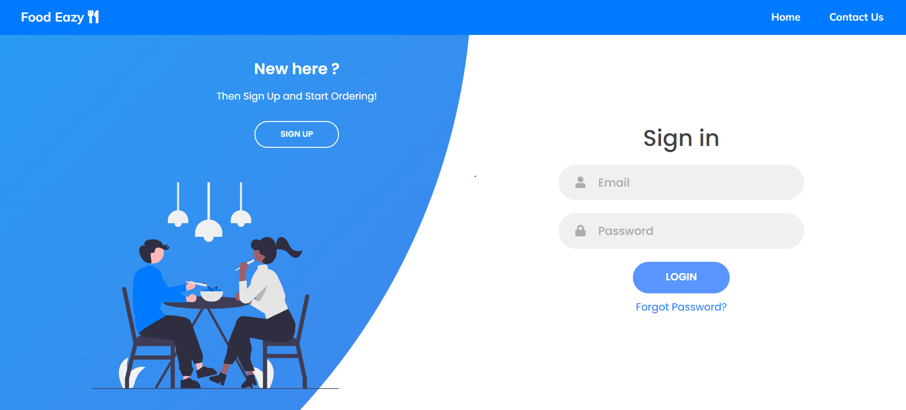
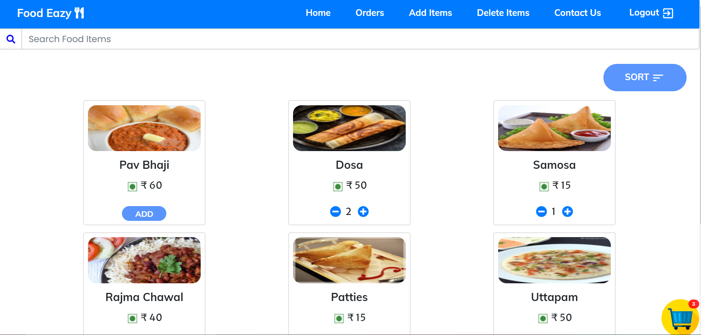
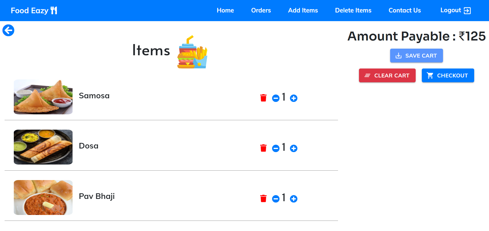
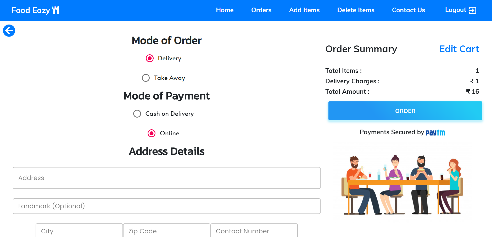
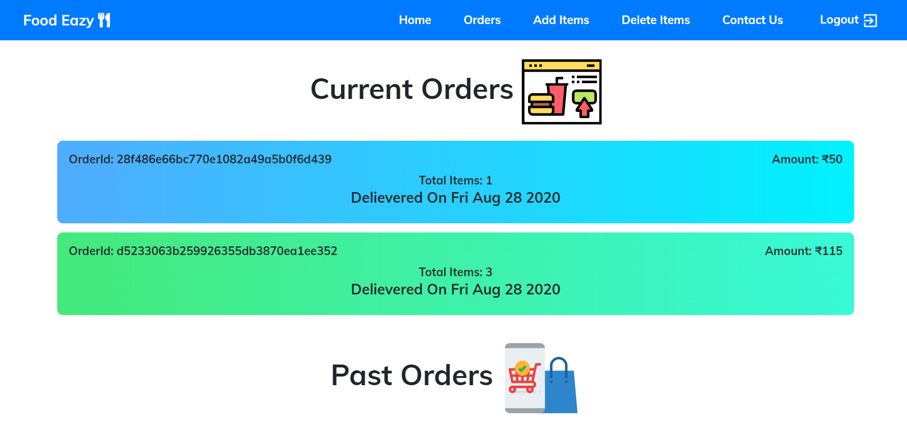
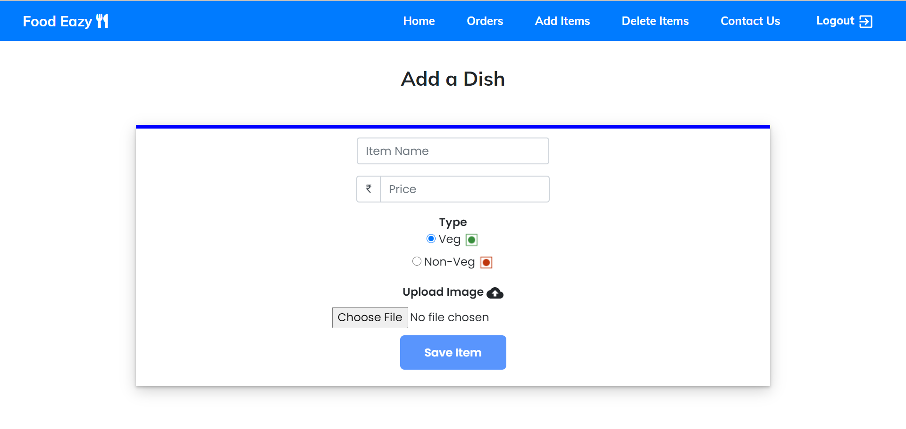

# Food Eazy

项目地址：<https://github.com/rick-peng-li/FoodEazy-web>

Food Eazy 是一个在线点餐平台，用户可以浏览菜品、搜索与排序、维护购物车、选择外卖或自取、使用货到付款或在线支付下单，并查看历史订单。管理员可以新增和删除菜品。项目采用前后端同域部署，前端构建产物由 Express 直接托管，适合在本地或容器环境中运行。

## 功能特性

### 用户端

- 注册、登录与 JWT 身份认证
- 邮箱验证码验证账号（未配置邮件服务时自动通过验证）
- 忘记密码与重置密码
- 菜品列表浏览、关键字搜索、按名称或价格排序
- 购物车增删改查与数量统计
- 结算时选择配送方式：外卖配送或到店自取
- 支付方式：货到付款（默认可用）或 PayTM 在线支付
- 下单成功后查看订单详情
- 个人订单列表，区分进行中与历史订单
- 响应式布局，移动端使用侧边栏导航

### 管理端

- 管理员角色校验
- 新增菜品：填写名称、价格、荤素类型并上传图片
- 删除菜品
- 图片支持 Cloudinary 云存储，未配置时自动保存到本地 `images` 目录

## 技术架构

| 层次 | 技术 |
| --- | --- |
| 前端 | React 16、Create React App、React Router 5、Context API + useReducer、Material UI 4、React Bootstrap、Axios、animate.css |
| 后端 | Node.js、Express 4、Mongoose 5、JWT、bcryptjs、express-validator、Multer、node-cron |
| 数据库 | MongoDB |
| 邮件 | Nodemailer + SendGrid（可选） |
| 图片存储 | Cloudinary（可选）、本地静态目录 |
| 在线支付 | PayTM 支付网关（可选） |

前端通过 Context 管理认证、菜品、购物车和加载状态；后端按路由模块拆分，统一挂在 `/api` 前缀下。生产模式下 Express 托管 `client/build` 静态资源，非 API 请求回退到 `index.html`，由前端路由接管。

## 目录结构

```text
FoodEazy-web/
├── client/                 前端工程
│   ├── public/             页面模板与图标
│   └── src/
│       ├── components/     页面与业务组件
│       ├── context/        认证、菜品、购物车、加载状态
│       ├── images/         前端静态图片
│       ├── App.js          路由入口
│       └── index.js        应用入口与 Axios 配置
├── config/                 数据库连接与配置映射
├── controllers/            上传中间件
├── middleware/             JWT 鉴权中间件
├── models/                 Mongoose 数据模型
├── routes/                 API 路由模块
├── scripts/seed.js         初始化演示数据
├── images/                 菜品图片静态目录
├── paytm/                  PayTM 校验和工具
├── server.js               Express 服务入口
├── DockerFile              镜像构建文件
├── .env.sample             环境变量示例
└── README.md
```

## 页面与路由

| 路由 | 页面 | 访问权限 |
| --- | --- | --- |
| `/` | 菜品首页，支持搜索与排序 | 登录且已验证 |
| `/auth` | 登录与注册 | 公开 |
| `/verify` | 邮箱验证码验证 | 公开 |
| `/forget` | 忘记密码，发送重置邮件 | 公开 |
| `/forget/:code` | 通过邮件链接重置密码 | 公开 |
| `/cart` | 购物车 | 登录且已验证 |
| `/checkout` | 结算页，选择配送方式与支付方式 | 登录且已验证 |
| `/success` | 下单成功与订单摘要 | 公开 |
| `/fail` | 支付失败提示 | 公开 |
| `/order` | 当前订单与历史订单 | 登录且已验证 |
| `/addproduct` | 新增菜品 | 登录且已验证，管理员 |
| `/deleteitems` | 删除菜品 | 登录且已验证，管理员 |
| `/contact` | 项目与开发者信息 | 公开 |

## 接口说明

所有接口均以 `/api` 为前缀。需要登录的接口通过请求头 `x-auth-token` 携带 JWT。

### 认证与账号

| 方法 | 路径 | 说明 | 鉴权 |
| --- | --- | --- | --- |
| POST | `/api/register` | 注册账号并返回 Token | 否 |
| POST | `/api/login` | 登录并返回 Token | 否 |
| GET | `/api/login` | 获取当前登录用户信息 | 是 |
| POST | `/api/verify` | 校验邮箱验证码 | 否 |
| POST | `/api/resend` | 重新发送验证码 | 否 |
| POST | `/api/forget` | 发送重置密码邮件 | 否 |
| GET | `/api/reset?code=` | 校验重置链接是否有效 | 否 |
| POST | `/api/reset` | 提交新密码 | 否 |

### 菜品

| 方法 | 路径 | 说明 | 鉴权 |
| --- | --- | --- | --- |
| GET | `/api/items` | 获取菜品列表 | 否 |
| GET | `/api/admin/items` | 获取全部菜品（管理端） | 否 |
| POST | `/api/admin/upload` | 新增菜品，`multipart/form-data` 上传图片 | 是，管理员 |
| POST | `/api/admin/items` | 按名称删除菜品 | 是，管理员 |

### 购物车

| 方法 | 路径 | 说明 | 鉴权 |
| --- | --- | --- | --- |
| GET | `/api/cart` | 获取当前用户购物车 | 是 |
| POST | `/api/cart` | 保存购物车 | 否，请求体携带 `user_id` |
| PUT | `/api/cart` | 清空购物车 | 是 |

### 订单与支付

| 方法 | 路径 | 说明 | 鉴权 |
| --- | --- | --- | --- |
| POST | `/api/orders` | 创建订单（自取或到付） | 是 |
| GET | `/api/orders?orderid=` | 查询订单详情 | 否 |
| GET | `/api/get_orders` | 获取当前用户订单列表 | 是 |
| POST | `/api/paytm` | 发起 PayTM 在线支付 | 是 |
| POST | `/api/paytm/success` | PayTM 支付回调 | 否 |

### 静态资源

| 方法 | 路径 | 说明 |
| --- | --- | --- |
| GET | `/images/:file` | 菜品图片与本地上传图片 |

## 环境变量

将 `.env.sample` 复制为 `.env` 后按需修改：

| 变量 | 默认值 | 说明 |
| --- | --- | --- |
| `PORT` | `5000` | 服务端口 |
| `MONGODB_URI` | `mongodb://127.0.0.1:27017/foodeazy` | MongoDB 连接地址 |
| `JWT_SECRET` | `food_eazy_dev_secret` | JWT 签名密钥 |
| `PUBLIC_BASE_URL` | `http://localhost:5000` | 邮件链接与支付回调的站点地址 |
| `SEND_GRID_KEY` | 空 | SendGrid 密钥，留空时跳过邮件发送 |
| `CLOUDINARY_CLOUD_NAME` | 空 | Cloudinary 云名称 |
| `CLOUDINARY_API_KEY` | 空 | Cloudinary API Key |
| `CLOUDINARY_API_SECRET` | 空 | Cloudinary API Secret |
| `PAYTM_MERCHANT_ID` | 空 | PayTM 商户号 |
| `PAYTM_MERCHANT_API_KEY` | 空 | PayTM 商户密钥 |
| `PAYTM_TXN_URL` | 测试网关地址 | PayTM 交易地址 |

前端接口地址通过 `client/.env` 中的 `REACT_APP_API_URL` 配置，留空表示与后端同域。

## 快速开始

### 前置条件

- Node.js 18 及以上
- MongoDB 实例，可使用本地服务或 Docker 容器

### 本地运行

```bash
cd FoodEazy-web
npm install
npm run install-client
npm run seed      # 写入演示账号与菜品
npm run build     # 构建前端到 client/build
npm start         # 启动 Express，默认读取 .env 中的 5050 端口
```

打开 <http://localhost:5050>。

macOS 的 AirPlay 接收器会占用 5000 端口，因此仓库内的 `.env` 使用 5050。若 5000 端口空闲，可将 `.env` 与 `client/package.json` 中的代理端口统一改为 5000。

MongoDB 使用 Docker 启动示例：

```bash
docker run -d --name foodeazy-mongo -p 27017:27017 mongo:7.0
```

### 开发模式

前后端分别热更新，前端开发服务器通过 `client/package.json` 的 `proxy` 转发接口请求：

```bash
npm run dev
```

前端运行在 <http://localhost:3000>，后端运行在 `.env` 指定的端口。

### Docker 运行

```bash
docker build -t food-eazy .
docker run -d --name food-eazy \
  -p 5050:5000 \
  -e MONGODB_URI=mongodb://host.docker.internal:27017/foodeazy \
  food-eazy
docker exec food-eazy node scripts/seed.js
```

打开 <http://localhost:5050>。Linux 环境若不支持 `host.docker.internal`，可改用宿主机 IP 或 `--network host`。

## 演示账号

| 角色 | 邮箱 | 密码 |
| --- | --- | --- |
| 管理员 | `admin@foodeazy.com` | `Admin@123` |
| 普通用户 | `user@foodeazy.com` | `User@123` |

账号由 `npm run seed` 创建，默认已完成邮箱验证。注册新账号时，如果未配置 `SEND_GRID_KEY`，账号会自动通过验证，验证码同时打印在服务端日志中。

## 可选服务说明

- **邮件**：未配置 SendGrid 时，注册验证码会输出到服务端日志，订单确认邮件会被跳过，不影响下单流程。
- **图片上传**：未配置 Cloudinary 时，图片保存到 `images/` 目录并通过 `/images/文件名` 访问。
- **在线支付**：未配置 PayTM 商户参数时，结算页请选择货到付款；选择在线支付会提示支付服务未配置。

## 界面预览

| 登录 | 首页 |
| --- | --- |
|  |  |

| 购物车 | 结算 |
| --- | --- |
|  |  |

| 订单 | 新增菜品 |
| --- | --- |
|  |  |
